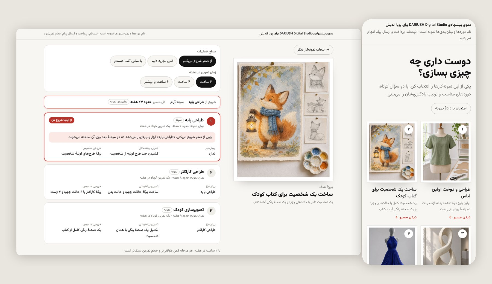

<div align="center">
  <h1>Art School Learning Path Demo</h1>
  <p><b>A Persian, right-to-left web demo: a learner picks the artwork they want to make, answers two questions, and gets a three-stage course path with a starting point and a summary to copy for a consultation.</b></p>
  <p>Proposal demo by <b>DARIUSH Digital Studio</b> for <b>Pooya Andish</b> art school · course names and schedules are samples</p>
  <p>
    <a href="https://dariush-tech.github.io/pooya-andish-path-demo/"><b>Live demo</b></a> ·
    <a href="#demo-flow">Demo flow</a> ·
    <a href="#editing-the-rules">Editing the rules</a> ·
    <a href="#run-locally">Run locally</a>
  </p>
  <p>
    
    
    
    
    
  </p>
  
</div>

<div dir="rtl">

### خلاصه

دموی پیشنهادی DARIUSH Digital Studio برای مرکز آموزش هنر پویا اندیش. صفحه با پرسش «دوست داری چه چیزی بسازی؟» و چهار نمونه‌کار شروع می‌شود: طراحی و دوخت اولین لباس، ساخت یک شخصیت برای کتاب کودک، ساخت یک مجسمهٔ دکوراتیو و طراحی سه‌بعدی لباس. پس از انتخاب، فقط دو سؤال پرسیده می‌شود (سطح فعلی و زمان تمرین در هفته) و مسیر سه‌مرحله‌ای با نام دورهٔ نمونه، پیش‌نیاز، تمرین پیشنهادی و خروجی ملموس هر مرحله نمایش داده می‌شود. مرحلهٔ شروع با دلیل کوتاه برجسته است، با تغییر هر پاسخ نتیجه همان لحظه به‌روز می‌شود و «کپی خلاصه برای مشاوره» پروژهٔ هدف، سطح، زمان تمرین و مرحلهٔ شروع را کپی می‌کند. هیچ ثبت‌نام، پرداخت یا پیامی انجام نمی‌شود.

</div>

## Demo flow

1. **Pick an artwork.** Four framed sample works, each with a short description of the final result. Tapping one opens its path.
2. **Answer two questions.** Current level (from zero, a little experience, familiar with the basics) and weekly practice time (2, 4, or 6+ hours). The path updates the moment an answer changes.
3. **Read the path.** Three stages, each with a sample course name, prerequisite, suggested exercise and tangible output. The starting stage is highlighted with a one-line reason, and the summary bar shows the start, pace and estimated length.
4. **Copy the summary.** «کپی خلاصه برای مشاوره» copies the target project, level, practice time and starting stage, plus the full path, as Persian-first lines that stay right-to-left in messaging apps.
5. **Try sample data.** «امتحان با دادهٔ نمونه» cycles through four ready combinations, starting with the character-for-a-children's-book path for a beginner.

## Path rules

| Level | Path | Start |
|---|---|---|
| از صفر شروع می‌کنم | fundamentals → applied practice → main project | fundamentals |
| کمی تجربه دارم | short refresher → applied practice → main project | refresher |
| با مبانی آشنا هستم | applied practice → main project → advanced stage (fundamentals shown as optional) | applied practice |

| Weekly practice | Pace | Effect |
|---|---|---|
| ۲ ساعت | slow | each stage about 1.5× longer, one short exercise a week |
| ۴ ساعت | steady | base length, two exercises a week |
| ۶ ساعت یا بیشتر | fast | each stage about 0.75× as long, three exercises plus a free one |

## Editing the rules

All rules live in plain objects at the top of the script in `index.html`, with Persian comments:

- `PROJECTS`: the four projects. Each has five possible stages (`base`, `refresh`, `core`, `apply`, `next`) with `course`, `prereq`, `practice`, `output` and `weeks` at four hours a week.
- `LEVELS`: which three stages each level gets, which stage becomes optional, and the reason shown for the start.
- `TIME`: the length factor, pace label and exercise volume for each weekly time.
- `SAMPLES`: the combinations the sample-data button steps through.

Changing a course name or a number in these objects is enough; no build step is needed.

## Features

- Gallery-style start view with framed artwork and museum-style labels; cards are large and easy to tap on phones.
- Questions sit directly above the result, so every change is visible at once on a phone; the summary and the starting stage flash briefly when they change.
- Course names carry a «نمونه» tag and every duration is labelled as a sample schedule.
- Copy through the Clipboard API, with a select-and-copy fallback in an expandable text box.
- The last choice is kept in `localStorage`; the page works fully offline once loaded.
- Light and dark themes, phone and desktop layouts, keyboard-accessible radio groups.

## Project structure

```
pooya-andish-path-demo/
├── index.html   # markup, styles, rules, scripts and the four artwork images (single file, no build step)
└── docs/        # README media
```

## Run locally

```bash
git clone https://github.com/dariush-tech/pooya-andish-path-demo.git
cd pooya-andish-path-demo
python3 -m http.server 8000
# open http://localhost:8000
```

## Notes

- The artwork images are sample works made for this demo, not student work from Pooya Andish.
- Course names, prerequisites and schedules are samples, not the school's official programme.

---

Design & development: [Dariush Technology](https://github.com/dariush-tech) · DARIUSH Digital Studio
